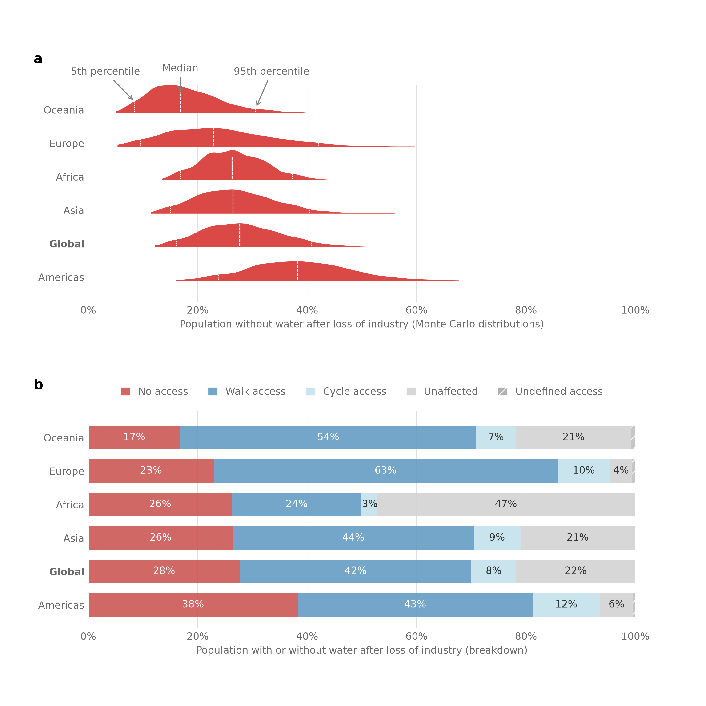

# Water-Access
---


<!-- [](https://doi.org/10.5281/zenodo.6866654) -->

[](https://opensource.org/licenses/Apache-2.0)

---
The Water Access model is a tool that simulates global access to freshwater sources by walking or cycling in the event of global catastrophic infrastructure loss (CIL). The output of the model can be used to identify areas at various resolutions (global, continental, country, district, and 5-arcminute zonal) which will be at highest risk of water insecurity in a catastrophe. This model can be useful for researchers, developers, and disaster response teams who are interested in understanding the potential impact of CIL on water access. The model is implemented in Python and its outputs have the potential to be integrated into other analysis and visualization tools (e.g., QGIS).



## Installation
To install the Water Access package, we recommend setting up a virtual environment using [mamba](https://mamba.readthedocs.io/) (faster) or `conda`. This will ensure that the package and its dependencies are isolated from other projects on your machine, which can prevent conflicts and make it easier to manage your dependencies. Here are the steps to follow:

* Create a virtual environment using either conda by running the command `mamba env create -f environment.yml`. This will create an environment called "water-access". A virtual environment is like a separate Python environment, which you can think of as a separate "room" for your project to live in, it's own space which is isolated from the rest of the system, and it will have it's own set of packages and dependencies, that way you can work on different projects with different versions of packages without interfering with each other.

Input data is stored with [Git LFS](https://git-lfs.com/). Install LFS and run `git lfs pull` after cloning.


```bash
git lfs install
git lfs pull
mamba env create -f environment.yml
mamba activate water-access
pip install -e .
```

For Jupyter notebooks, register a kernel:

```bash
python -m ipykernel install --user --name=water-access
```

If imports fail in the notebook kernel, rerun `pip install -e .` from the repository root.

* Alternatively, you may wish to run the notebook in an IDE such as Visual Studio Code (instructions [here](https://code.visualstudio.com/docs/datascience/jupyter-notebooks))

## Repository structure

```
├── data/           Input data (GIS, lookup tables, processed)
├── docs/           Full reproduction workflow
├── gcp/            Optional cloud deployment for large Monte Carlo runs
├── results/        Model outputs (CSVs, parquets, plots)
├── scripts/        Notebooks and processing scripts
├── src/            Core model code
└── tests/          Unit tests
```

## Quick start

### Explore existing results

Run [`scripts/key_results.ipynb`](scripts/key_results.ipynb) and [`scripts/distribution_plots.ipynb`](scripts/distribution_plots.ipynb) to generate key tables and plots from the summary CSVs in `results/`.

### Re-run the model with new assumptions

1. Run [`scripts/run_monte_carlo_gcp.py`](scripts/run_monte_carlo_gcp.py) — Monte Carlo simulations (the single driver; parameter ranges are defined at the top of the script). Deployed to a Spot VM by [`gcp/deploy-spot.sh`](gcp/deploy-spot.sh); for a small local test run, lower `NUM_ITERATIONS`/`MAX_WORKERS` at the top of the script.
2. Run [`scripts/key_results.ipynb`](scripts/key_results.ipynb) and [`scripts/distribution_plots.ipynb`](scripts/distribution_plots.ipynb) to analyze the new outputs.

For a single deterministic run (no Monte Carlo), use [`src/gis_global_module.py`](src/gis_global_module.py).

For large runs on Google Cloud Spot VMs, see [`gcp/gcp-setup.md`](gcp/gcp-setup.md).

### Unpiped source breakdown (JMP country files)

The model splits non-piped drinking-water users by JMP source type (packaged, delivered, borehole/tubewell, and other resilient unpiped). Household survey columns are matched to each country's latest piped reference year within a 5-year window, taken from the same JMP/WHO global CSV used for piped shares. If tracked unpiped subcategories (packaged + delivered + borehole) plus other unpiped sources (standpipe, wells, springs, rainwater, etc.) exceed the unpiped budget (`100% − piped`), all unpiped shares are scaled proportionally. To refresh these inputs from WHO/UNICEF JMP household country files:

```bash
# 1. Download country xlsx files (copies from ../well-coverage/data/raw if present)
python scripts/Data_Manipulation_Scripts/download_jmp_country_files.py

# 2. Parse source-type percentages for all countries
python scripts/Data_Manipulation_Scripts/extract_jmp_source_breakdown.py

# 3. Merge in researched fills for the countries whose JMP files are blank
#    (data/original_data/researched_source_breakdown.csv; see its README)
python scripts/Data_Manipulation_Scripts/build_unified_source_breakdown.py

# 4. Rebuild merged_data.csv (adds URBAN/RURAL Packaged, Delivered, Borehole, OtherUnpiped columns)
python scripts/Data_Manipulation_Scripts/imputation_script.py
```

Of the 76 countries with blank JMP source breakdowns (mostly high-income and
small-island territories), 53 are filled from national censuses, DHS/EPHS
reports and regulator statistics, with per-row provenance, confidence, and
verification status (the other 23 were judged not fillable from available
sources). Sources, the mapping rubric, and the piped-share
reconciliation rule (unpiped-budget scaling with a rounded-piped carve-out)
are documented in
[`data/original_data/researched_source_breakdown_README.md`](data/original_data/researched_source_breakdown_README.md).

Code defaults for borehole displacement are 50% urban, 25% rural (JMP does not distinguish handpump vs motorized), but researched estimates now exist and supersede them: HEMP-scenario ranges of 63–80% urban and 23–35% rural, population-weighted from per-country handpump-share bounds — see [`ELECTRIC_BOREHOLE_SHARE_ESTIMATE.md`](ELECTRIC_BOREHOLE_SHARE_ESTIMATE.md), the per-country table in [`BOREHOLE_PUMP_TYPE_BY_COUNTRY.md`](BOREHOLE_PUMP_TYPE_BY_COUNTRY.md), and `data/original_data/borehole_pump_type_estimates.csv` (reproduce the aggregation with `scripts/Data_Manipulation_Scripts/aggregate_borehole_pump_estimates.py`). Displaced users — piped, packaged, delivered, and the displaced borehole share — all regain access only if walking or cycling range allows. Resilient unpiped users are the residual share after subtracting those displaced categories from total unpiped (`100% − piped`). Parsed `OtherUnpiped` columns are used only when scaling survey breakdowns to the unpiped budget. Override via `urban_borehole_lose_fraction` and `rural_borehole_lose_fraction` in `calculate_population_water_access()`.

## Full reproduction

Step-by-step instructions to reproduce the full analysis pipeline (including QGIS map outputs) are in [`docs/README.md`](docs/readme.md).

